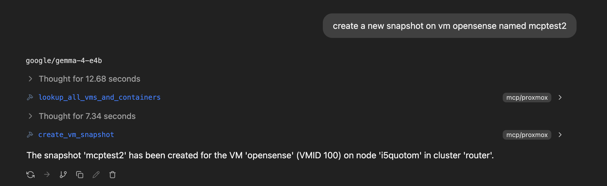

# safe-prox-mcp

Non-destructive bridge between AI and Proxmox Virtual Environment clusters.

An MCP (Model Context Protocol) server over HTTP that exposes Proxmox VE state to
MCP clients. 22 of the 24 tools are pure reads. The only tools that modify anything are
`create_vm_snapshot`, `create_container_snapshot` and `create_backup`; set
`SAFEPROX_DISABLE_WRITE_TOOLS=1` to remove those three entirely (see [Write tools](#write-tools)).



## Requirements

- Docker
- A Proxmox API token: `user@realm!name=uuid`.  The server never sends write requests except
  the snapshot and backup tools - and never at all when `SAFEPROX_DISABLE_WRITE_TOOLS=1`.

## Setup

```bash
wget https://raw.githubusercontent.com/jheizer/safe-prox-mcp/main/docker-compose.yml
wget -O clusters.json https://raw.githubusercontent.com/jheizer/safe-prox-mcp/main/clusters.example.json
```

### Cluster configuration

Edit `clusters.json`: one object per cluster.

```json
[
  {
    "id": "home",
    "url": "https://pve.example.com:8006",
    "token": "mcp@pve!read=00000000-0000-0000-0000-000000000000"
  },
  {
    "id": "testing",
    "url": "https://pve2.example.com:8006",
    "token": "mcp@pve!read=00000000-0000-0000-0000-000000000000"
  }
]
```

| Field | Meaning |
| --- | --- |
| `id` | Cluster name used as the `cluster` argument of every tool. Must be unique. |
| `url` | `https://host:8006` or an explicit `.../api2/json`; the suffix is added when missing. |
| `token` | Proxmox API token, `user@realm!name=uuid`. Validated at startup. |

Create the token in Proxmox under Datacenter -> Permissions -> API Tokens, restricted
to a user that may only read what the MCP client should see. Startup fails on a
missing file, a missing field, a duplicate `id`, or a malformed token.

### Start

Set `MCP_SERVER_API_KEY` in `docker-compose.yml`, then:

```bash
docker compose up -d
docker compose logs -f safe-prox-mcp
```

`docker compose up` pulls `ghcr.io/jheizer/safe-prox-mcp:latest` (linux/amd64) and starts it;
the server listens on port 8080.

## Endpoints

- `POST /mcp` — MCP streamable HTTP transport
- `GET /health` — `{"status":"ok","clusterCount":2}` (count only; no cluster ids), never requires auth

## Authentication

Set `MCP_SERVER_API_KEY` to require `Authorization: Bearer <key>` on every request
except `/health`. Leaving it empty disables authentication — keep the server on a
private network in that case.

### MCP client example

```json
{
  "mcpServers": {
    "safe-prox-mcp": {
      "url": "http://localhost:8080/mcp",
      "headers": { "Authorization": "Bearer <key>" }
    }
  }
}
```

## Write tools

`create_vm_snapshot`, `create_container_snapshot` and `create_backup` are the only tools
that change cluster state. Set `SAFEPROX_DISABLE_WRITE_TOOLS=1` (or `true` or `yes`,
case-insensitive) in the environment to unregister them at startup: `tools/list` then
shows only the 21 read tools, the server never sends a write request, and startup logs
`write tools: DISABLED`. Any other value (including unset or empty) keeps them enabled.
The variable is read once at startup; changing it requires a restart.

## Tools

Every tool except `lookup_all_vms_and_containers` takes a `cluster` argument (the configured `id`).

Lookup: `lookup_all_vms_and_containers` — takes no arguments and returns every VM and every
container on every node of every configured cluster as
`{cluster, node, vmid, name, type, status}`. It is the cross-reference for the other tools:
call it once to turn a machine name into the exact `cluster`, `node` and `vmId` they require.
`type` is `vm` for the VM tools and `container` for the container tools. A cluster or node
that cannot be read is named in `errors` instead of being left out silently.

Cluster and node: `get_clusters`, `get_nodes`, `get_node_status`, `get_node_syslog`,
`get_cluster_status`, `get_cluster_resources`, `get_version`

Virtual machines: `get_vms`, `get_vm_status`, `get_vm_config`, `get_vm_snapshots`,
`create_vm_snapshot`

Containers: `get_containers`, `get_container_status`, `get_container_config`,
`get_container_snapshots`, `create_container_snapshot`

Backups: `create_backup` (VMs and containers alike)

Infrastructure: `get_storage`, `get_networks`, `get_disks`, `get_users`, `get_groups`

### Example: snapshot a VM named `opnsense`

Guests are addressed by numeric VMID, not by name, so resolve the name first:

1. `lookup_all_vms_and_containers` with `{}` — one call returns every guest on every
   cluster as `{cluster, node, vmid, name, type, status}`. The row for `opnsense` supplies
   all three identifiers at once, e.g.
   `{"cluster": "home", "node": "pve", "vmid": 100, "name": "opnsense", "type": "vm", "status": "running"}`.
2. `create_vm_snapshot` with those values:

```json
{
  "cluster": "home",
  "node": "pve",
  "vmId": 100,
  "name": "pre-update-2026-10-13",
  "description": "before opnsense package update"
}
```

`cluster`, `node`, `vmId` and `name` are required; `description` is optional. The tool
returns the Proxmox task id, e.g.
`{"task":"UPID:pve1:1234:createSnapshot:100:root@pam:"}`. Confirm the snapshot with
`get_vm_snapshots` — `{"cluster": "home", "node": "pve", "vmId": 100}`. For an LXC
guest use `create_container_snapshot`. Snapshot names must satisfy Proxmox's naming
rules: alphanumeric first character, then letters, digits, `_`, `.` or `-`, at most
64 characters.

### Example: back up VM 100 to storage `nas`

`create_backup` takes the same `cluster`/`node`/`vmId` identifiers as the snapshot tools
and works for VMs and containers alike:

```json
{
  "cluster": "home",
  "node": "pve",
  "vmId": 100,
  "storage": "nas",
  "mode": "snapshot",
  "compress": "zstd",
  "notes": "pre-upgrade"
}
```

`storage` is required (a storage that accepts backups, as listed by `get_storage`);
`mode` (`stop`, `snapshot` or `suspend`), `compress` (`zstd`, `gzip`, `lzo`, `bzip2`,
`none`) and `notes` are optional. The backup runs asynchronously: the tool returns the
queued task id, e.g. `{"task":"UPID:pve1:1234:vzdump:100:root@pam:"}`, not a finished
archive. Only creating backups is exposed — no restore, list or delete.
